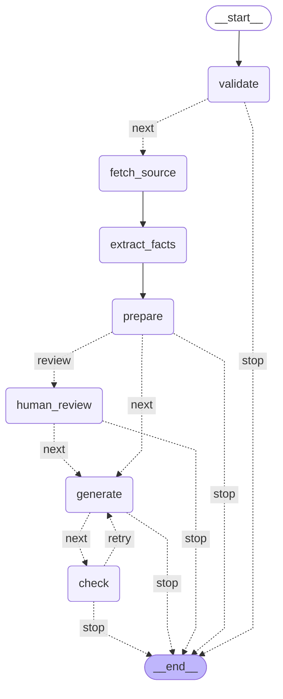

# AI-помощник для товарных описаний

Локальный прототип по тестовому заданию СОЮЗ-ПРИБОР. Принимает JSON с данными
прибора и готовит черновик карточки для B2B-магазина:

- SEO-заголовок до 70 символов;
- описание на 800–1200 символов;
- список характеристик;
- 3–5 поисковых запросов;
- краткий блок для менеджера: кому подходит прибор и какие задачи решает.

Результат можно скопировать или скачать в JSON и Markdown.

Граф — это последовательность шагов, которые проходят данные товара:

- Проверка входа (validate) — проверяет JSON и название прибора.
- Получение страницы (fetch_source) — при включённом дообогащении загружает страницу по URL. Если сайт недоступен, сохраняет исходные данные и предупреждает.
- Извлечение характеристик (extract_facts) — находит явно указанные параметры в описаниях и сохраняет фрагменты, из которых они взяты.
- Подготовка фактов (prepare) — объединяет сведения, находит пропуски и расхождения, проверяет, достаточно ли данных для текста.
- Выбор спорных значений (human_review) — нужен только при расхождении JSON и сайта. Система ждёт выбора пользователя и затем продолжает работу.
- Создание карточки (generate) — выбранная модель пишет черновик на основе подготовленных фактов.
- Проверка результата (check) — проверяет формат, длину текста, поисковые запросы и числовые характеристики. При замечаниях отправляет текст на одну доработку, затем показывает результат и оставшиеся замечания.


## Установка и запуск

Нужен Python 3.11 или новее. Выполняйте команды из папки проекта.

**Linux/macOS:**

```bash
python3 -m venv venv
source venv/bin/activate
python -m pip install -r requirements.txt
cp .env.example .env
python main.py
```

**Windows, PowerShell:**

```powershell
py -3 -m venv venv
.\venv\Scripts\python.exe -m pip install -r requirements.txt
Copy-Item .env.example .env
.\venv\Scripts\python.exe main.py
```

Если команда `py` недоступна, используйте `python` вместо `py -3`.
Копируйте `.env.example` только при первой настройке, чтобы не затереть ключи.
Для повторного запуска достаточно активировать окружение и выполнить `python main.py`;
на Windows — выполнить последнюю команду из блока выше.

Откройте адрес из терминала, обычно http://localhost:8501. Остановка — `Ctrl+C`.
Приложение доступно только на локальном компьютере.

## Подключение модели

В боковой панели выберите провайдера и модель. По умолчанию выбран Codex CLI;
для другого подключения подготовьте доступ по таблице.

| Подключение | Что нужно |
|---|---|
| OpenAI | `OPENAI_API_KEY` в `.env` |
| Anthropic | `ANTHROPIC_API_KEY` в `.env` |
| Google Gemini | `GEMINI_API_KEY` в `.env` |
| Локальный API | Отдельно запущенный совместимый сервер, адрес с `/v1`; при необходимости `LOCAL_MODEL_API_KEY` |
| Codex CLI | Отдельно установленный CLI и авторизация через `codex login` |

После изменения ключей перезапустите приложение. `.env` исключён из Git.
Список моделей загружается от провайдера, для Codex — из локального кэша.
Если список пуст или устарел, нажмите «Обновить список моделей».
Для Codex без кэша сначала откройте авторизованный CLI.

Codex обращается к облачной модели и расходует лимиты аккаунта.
Нужна версия с поддержкой `--ignore-user-config`, `--ephemeral` и `--output-schema`;
в окружении разработки использовалась версия 0.166.0.

## Как пользоваться

1. Выберите подключение и модель.
2. Подставьте один из примеров или вставьте JSON своего товара.
3. При необходимости включите дополнение данных со страницы товара.
4. Нажмите «Сформировать черновик».
5. Если данные JSON и сайта расходятся, выберите значение каждого спорного параметра
   или «Пока неизвестно». Генерация продолжится после выбора.
6. Проверьте текст и замечания, затем откройте «Скопировать или скачать результат».

На вкладке «Примеры сценариев» можно проверить семь искусственных случаев,
включая ошибки входа и конфликты. Кнопка «Проверить сценарий без модели» работает
без ключей и интернета, используя локальные HTML-примеры; текст карточки не генерируется.

## Формат входа

```json
{
  "name": "Название и точное исполнение",
  "manufacturer": "Производитель",
  "specs": {"Интерфейс": "RS-485", "Питание": "24 В"},
  "description": "Подтверждённое назначение и фрагмент технического описания.",
  "url": "https://www.souz-pribor.ru/product/адрес-товара/",
  "product_code": "код товара, если известен"
}
```

Обязательно непустое `name`. Остальные поля можно опустить. Значения `specs` —
строки или числа; пустая строка превращается в «данных нет». Некорректный JSON,
неверные типы, `null` и повторные ключи отклоняются.

Для генерации нужны две непустые непротиворечивые технические характеристики
либо содержательное описание назначения и хотя бы одна характеристика.
При недостатке данных модель не вызывается. Это простой порог достаточности,
а не проверка полноты паспорта. `product_code` сохраняется для справки.

## Как устроена обработка

Последовательностью шагов управляет LangGraph:
проверка JSON → получение страницы → извлечение и объединение фактов →
выбор спорных значений → генерация → проверка результата.

Модель пишет только заголовок, описание, поисковые фразы и блок для менеджера.
Разбор источников, извлечение характеристик, поиск конфликтов, проверки и экспорт
выполняет Python-код. Характеристики собираются из подготовленных фактов.

Системный промпт находится в [prompts.json](prompts.json), поле `system_prompt`.
Его можно редактировать: файл читается перед каждым запросом без перезапуска приложения.
Сохраняйте формат JSON и кодировку UTF-8. Сообщение с фактами, схемой ответа и
замечаниями собирается в `src/card/prompts.py`.

При замечаниях проверки допускается одна повторная генерация — максимум два
обращения к выбранной модели на товар. История предыдущих товаров не передаётся.
Если замечания остаются, результат получает статус, требующий проверки.

Дообогащение поддерживает только HTTPS-страницы `/product/` сайта `souz-pribor.ru`.
Неоднозначные и противоречивые сведения исключаются из запроса; источники,
предупреждения и выбор пользователя сохраняются в экспорте.
Состояние выбора хранится в памяти: после перезапуска или изменения входа начните заново.

<details>
<summary>Схема графа</summary>

<!-- langgraph:start -->

<!-- langgraph:end -->

Обновление схемы из кода: `python scripts/update_graph.py`.

</details>

Основной код: `src/workflow.py` — граф, `src/card/` — работа с карточкой,
`src/llm/` — подключения моделей, `src/sources/` — разбор сайта,
`ui.py` и `src/ui/` — интерфейс.

## Примеры и проверки

Входы для двух товаров: [МК110](examples/mk110.json) и [ПМ01](examples/pm01.json).
Сохранённые результаты Codex CLI (`gpt-6.1-sol`):
[МК110](examples/reference_results/mk110.md) и [ПМ01](examples/reference_results/pm01.md).
Происхождение данных описано в [examples/README.md](examples/README.md).

Автоматические тесты без реальных вызовов моделей и сети:

```bash
python -m unittest discover -s tests -v
```

Тесты графа и интерфейса пропускаются, если LangGraph и Streamlit не установлены.

Отдельная проверка через авторизованный Codex:

```bash
python scripts/validate_codex.py --model gpt-6.1-sol
```

Укажите доступную вашему аккаунту модель. Команда расходует лимиты и сохраняет
ответы в `examples/results/`, исключённую из Git. Эталонные результаты не перезаписываются.

## Ограничения и дальнейшие улучшения

- Автоматическая проверка не гарантирует достоверность всего текста. Она проверяет
  формат, длины, числа и часть технических утверждений. Перед публикацией нужен просмотр человеком.
- Извлечение фактов и поиск конфликтов основаны на правилах и небольшом списке синонимов.
  Произвольные формулировки могут быть пропущены; единицы измерения не пересчитываются.
- Разбор сайта зависит от вёрстки; сложные таблицы и разные исполнения требуют проверки.
- Нет загрузки паспортов PDF, поиска товаров по названию и массовой обработки XML.
  Поисковые фразы предлагает модель; статистика спроса не проверяется.
- Реальные результаты получены через Codex CLI. Остальные подключения проверены
  подставными ответами. Интерфейс проверялся через AppTest, отдельной проверки в браузере не было.
- Зависимости заданы без lock-файла.

Следующие шаги: схемы обязательных характеристик по категориям, более точное
сопоставление исполнений и проверка утверждений, затем поддержка PDF.
