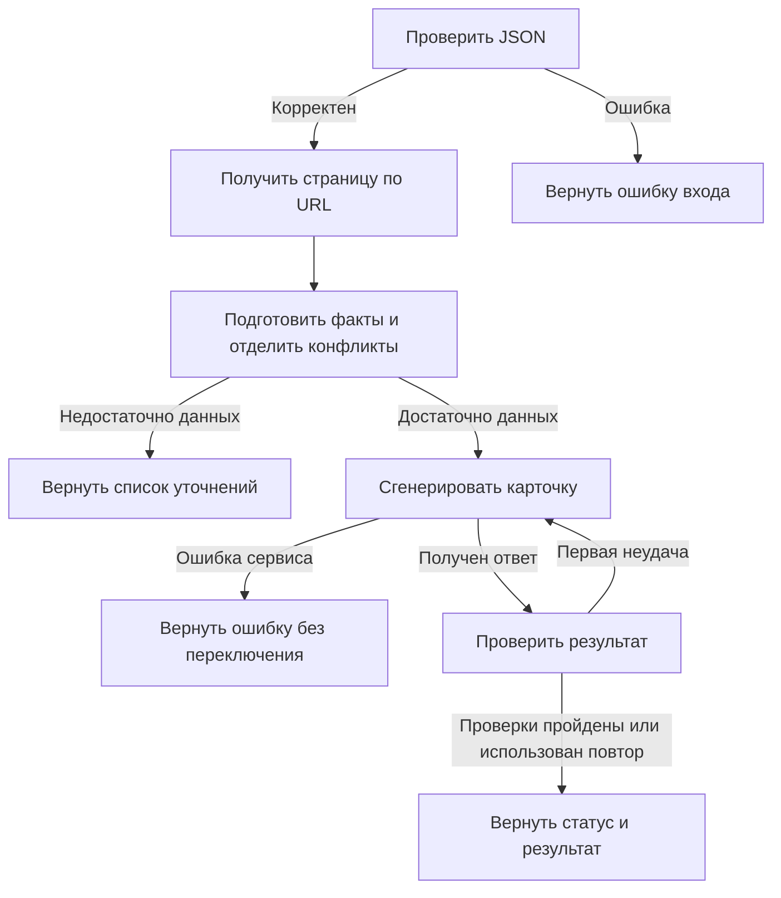

# AI-помощник для товарных описаний

Локальный прототип по тестовому заданию СОЮЗ-ПРИБОР. Из JSON с данными прибора
готовит черновик карточки для B2B-магазина. Модель и способ подключения выбираются
в веб-интерфейсе. Docker и `config.json` не нужны.

## Установка и запуск

Нужен Python 3.11 или новее. Команды ниже — для Linux/macOS, из папки проекта:

```bash
python3 -m venv venv
source venv/bin/activate
python3 -m pip install -r requirements.txt
cp .env.example .env
python3 main.py
```

Если `venv` уже создан, достаточно активировать его и установить зависимости.
В Windows активация: `venv\Scripts\activate`; вместо `python3` обычно используется `python`.
Откройте адрес из терминала, обычно http://localhost:8501. Остановка — `Ctrl+C`.
Сервер слушает только локальный компьютер. Установка зависимостей, запуск моделей
и авторизация автоматически не выполняются.

## Как пользоваться

1. Слева выберите подключение и «Название модели» из выпадающего списка.
2. Подставьте один из двух примеров или вставьте JSON своего товара.
3. При наличии URL дообогащение включено по умолчанию. Его можно отключить.
4. Нажмите «Сформировать черновик». Проверьте предупреждения, источники и конфликты.
5. Скопируйте результат кнопкой копирования в блоке кода или скачайте JSON/Markdown.

На один товар выполняется максимум два обращения к одной выбранной модели.
Изменение настроек само по себе не запускает генерацию. Каждый товар обрабатывается
без истории предыдущих запросов. При ошибке провайдер не меняется автоматически.

### Доступ к модели

| Подключение | Что подготовить |
|---|---|
| OpenAI | `OPENAI_API_KEY` в `.env` |
| Anthropic | `ANTHROPIC_API_KEY` в `.env` |
| Google Gemini | `GEMINI_API_KEY` в `.env` |
| Локальный API | Запустить совместимый сервер отдельно, указать модель и адрес `/v1`; при необходимости задать `LOCAL_MODEL_API_KEY` |
| Codex CLI | Установить CLI отдельно, выполнить `codex login`, указать доступную аккаунту модель |

Ключи не вводятся в код и не сохраняются в результат. `.env` исключён из Git.
После изменения ключей перезапустите приложение. Для облачных API сначала показан
небольшой список примеров. Кнопка «Обновить список моделей» получает каталог сервиса
с вашим ключом. Для локального API список загружается с `/v1/models`; сервер должен
быть запущен. Для Codex используются видимые модели из локального `models_cache.json`
в `CODEX_HOME` или `~/.codex`: чтение кэша не запускает модель. Если кэша нет,
откройте авторизованный Codex, затем обновите список в приложении. Кэш — внутренний
формат Codex и может потребовать адаптации при обновлении CLI.
Ручного ввода названия модели нет. Каталог не гарантирует поддержку нужного формата
ответа: она проверяется при генерации. Сетевые каталоги запрашиваются только по кнопке.

Codex запускается через `codex exec`, использует сохранённую авторизацию ChatGPT
и возвращает JSON по схеме. Локальный клиент обращается к облачной модели;
действуют лимиты аккаунта. API-ключи исключаются из окружения дочернего Codex.
Используется отдельная временная папка, режим чтения, отключённые shell-инструменты,
веб-поиск и пользовательская конфигурация. Глобальные настройки Codex не меняются.
Нужна версия CLI с поддержкой `--ignore-user-config`, `--ephemeral` и `--output-schema`.
В окружении разработки обнаружена 0.166.0; реальная генерация ею не запускалась.

## Входные данные

```json
{
  "name": "Название и точное исполнение",
  "manufacturer": "Производитель",
  "specs": {"Интерфейс": "RS-485", "Питание": "24 В"},
  "description": "Подтверждённое назначение и фрагмент технического описания.",
  "url": "https://www.souz-pribor.ru/product/адрес-товара/",
  "product_code": "код товара, если известен"
}
```

Обязательно непустое `name`. Остальные поля можно опустить. `specs` — объект со
строками или числами; пустая строка сохраняется как «данных нет». `null`, неверные
типы и неизвестные поля отклоняются. `product_code` сохраняется во входе для
идентификации человеком; автоматическое сопоставление по коду пока не реализовано.

Для генерации требуется описание или хотя бы две непустые непротиворечивые
характеристики. Это простой порог MVP, а не оценка полноты технического паспорта.
При недостатке данных модель не вызывается: интерфейс просит дополнить сведения.

## Граф обработки



| Узел | Назначение |
|---|---|
| `validate` | Проверяет структуру JSON и обязательное название |
| `fetch_source` | По возможности получает описание и таблицы со страницы заказчика; ошибка сайта не уничтожает исходные данные |
| `prepare` | Объединяет факты, сохраняет источники, отдельно выделяет пропуски и конфликты |
| `generate` | Передаёт разрешённые факты выбранной модели; при доработке добавляет замечания проверки |
| `check` | Проверяет формат, длины, количество запросов и неподтверждённые числовые обозначения |

Это `StateGraph` LangGraph. Сетевые подключения и узлы разделены: новый источник
можно подключить до подготовки фактов, новый провайдер — к узлу генерации.
База данных, сохранение диалогов и отдельные агенты для каждого шага не используются.

### Структура кода

```text
src/
├── models.py       # Форматы данных и ошибки
├── workflow.py     # Граф обработки
├── transport.py    # Общие HTTP-запросы
├── llm/            # Провайдеры, Codex и каталоги моделей
├── sources/        # Получение и разбор страниц товаров
└── card/           # Факты, промпты, проверка и экспорт карточки
```

В каждой папке есть `__init__.py`, обозначающий пакет Python.

## Источники и конфликты

Дообогащение поддерживает только HTTPS-страницы `/product/` домена `souz-pribor.ru`.
URL уже есть в исходном XML, поэтому поисковый API не требуется. Перенаправления,
посторонние домены и слишком большие ответы отклоняются.

Разборщик читает заголовок, раздел описания и таблицы характеристик. Меню, отзывы,
реклама и скрипты не используются. При отсутствии точного исполнения или
производителя в заголовке добавляются только строки, явно называющие исполнение.
Строки с несколькими исполнениями и неоднозначными пометками пропускаются.
При сравнении версий описание и некоторые зависимые от версии параметры исключаются.

Входные характеристики не перезаписываются молча. Различающиеся значения одного
поля показываются в отдельной таблице с источниками, а само поле исключается из
запроса к модели. То же относится к противоречивым строкам самой страницы.
При обнаружении конфликта свободные описания также исключаются: они могут повторять
спорный факт. Чтобы разрешить конфликт, проверьте источник, исправьте JSON и при
необходимости отключите дообогащение. В экспорте конфликты остаются видны.

## Результат и промпт

Карточка содержит заголовок до 70 символов, описание 800–1200 символов,
характеристики, 3–5 рекомендуемых поисковых запросов и краткий блок для менеджера.
Символы считаются с пробелами после удаления пробелов по краям поля.
Описание — текст страницы товара, а не HTML meta description.

Характеристики собираются кодом из фактов, а не переписываются моделью.
Промпт в `src/card/prompts.py` запрещает дополнять сведения из памяти,
расшифровывать исполнение и придумывать технические или коммерческие обещания.
Источники передаются как данные. Модель пишет только текстовые разделы и поисковые
фразы. Для OpenAI/Gemini и Codex запрашивается JSON Schema; для Anthropic и локального
API схема включена в промпт. Любой ответ затем проверяется кодом.

Статус «Черновик» означает прохождение формальных проверок, а не разрешение на
публикацию. После второй неудачи результат помечается как требующий проверки;
невалидный JSON не показывается как готовая карточка. Достоверность важнее объёма:
приложение не дописывает вымышленные факты для достижения 800 символов.

## Два товара для демонстрации

В `examples/mk110.json` и `examples/pm01.json` подготовлены входы по товарам из
`docs/feed.xml`. Источники, происхождение сведений и порядок сохранения результатов
описаны в [examples/README.md](examples/README.md).

**Результаты реальной генерации пока не получены.** Модели не запускались.
Для завершения сдачи нужно сформировать
обе карточки выбранной моделью, проверить и сохранить экспорт рядом с примерами.
Подставные ответы тестов не являются примерами работы LLM.

## Проверки

```bash
python3 -m unittest discover -s tests -v
```

Основные тесты работают без сторонних пакетов, сети и реальных моделей: входные
ошибки, дообогащение, конфликты, лимиты формата, сбои API, один повтор, отсутствие
истории, параметры и остановка Codex. Тесты настоящего графа и UI автоматически
пропускаются, если LangGraph и Streamlit не установлены. Зависимости для тестов
автоматически не устанавливаются.

## Ограничения и улучшения

- Семантическая достоверность всего текста автоматически не гарантируется.
  Проверка чисел не выявляет все выдуманные свойства: нужен просмотр человеком.
- Конфликты определяются по совпадающим именам и небольшому списку синонимов.
  Противоречия внутри свободного текста, пересчёт единиц и все варианты названий
  не распознаются. Совпадение числа не доказывает правильность его назначения.
- HTML-разбор рассчитан на текущие страницы заказчика; изменение вёрстки может
  потребовать правки. Это консервативный сборщик, а не универсальная система
  извлечения характеристик. Версионность и сложные таблицы требуют проверки.
- Автоматического поиска по названию, загрузки паспортов PDF, массового обхода XML
  и статистики частотности SEO-запросов нет. Поисковые фразы — рекомендации модели.
- Подключения API реализованы, но без реальных вызовов не считаются проверенными
  на конкретных моделях. Ограничения доступа и поддержка схем зависят от сервиса.
- Версии зависимостей ограничены диапазонами, но отдельный lock-файл не создавался.
  На Python 3.14 прошли 46 тестов, включая настоящий граф с подставной моделью
  и интерфейс через AppTest. Запуск в браузере и реальные вызовы моделей не проверялись.

При развитии проекта полезнее сначала добавить проверенные схемы характеристик
по категориям и сопоставление конкретных исполнений, затем обработку PDF и
измерение SEO-спроса. Docker можно добавить при появлении задачи размещения.

## Документация подключений

- [LangGraph: Graph API](https://docs.langchain.com/oss/python/langgraph/graph-api)
- [OpenAI: Chat Completions](https://developers.openai.com/api/reference/resources/chat/subresources/completions/methods/create)
- [Anthropic: Messages](https://platform.claude.com/docs/en/api/messages)
- [Gemini: совместимый API](https://ai.google.dev/gemini-api/docs/openai)
- [Codex: запуск из скриптов](https://learn.chatgpt.com/docs/non-interactive-mode)
